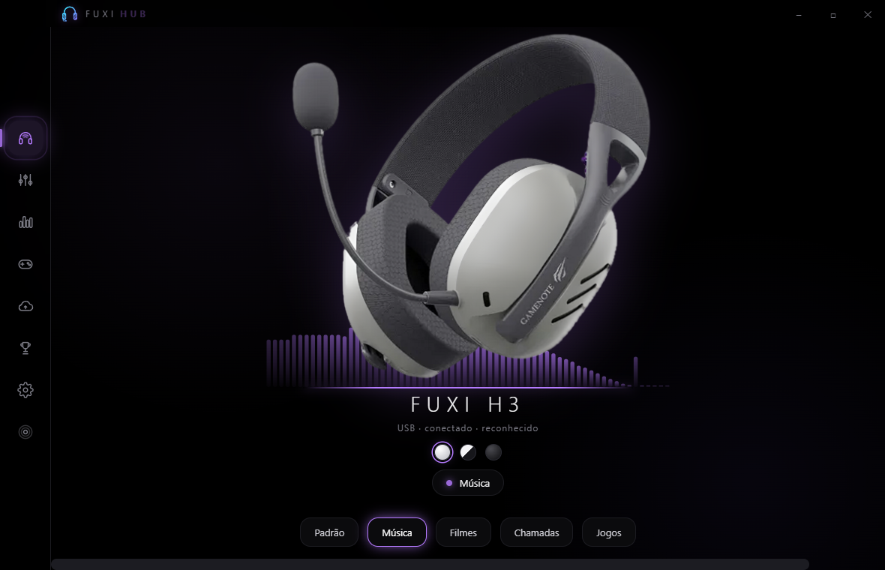
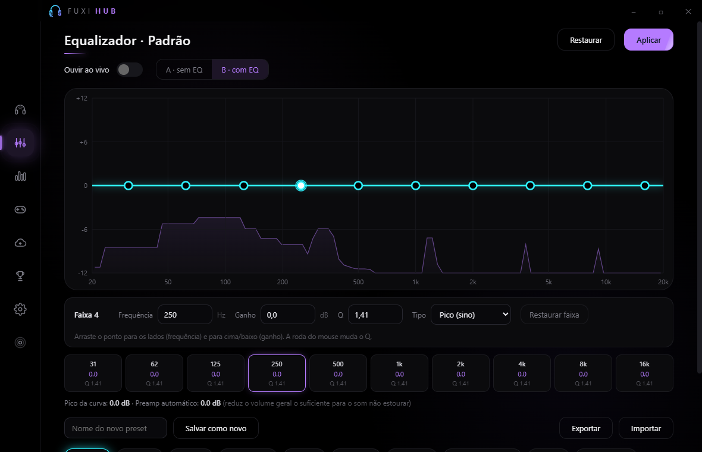
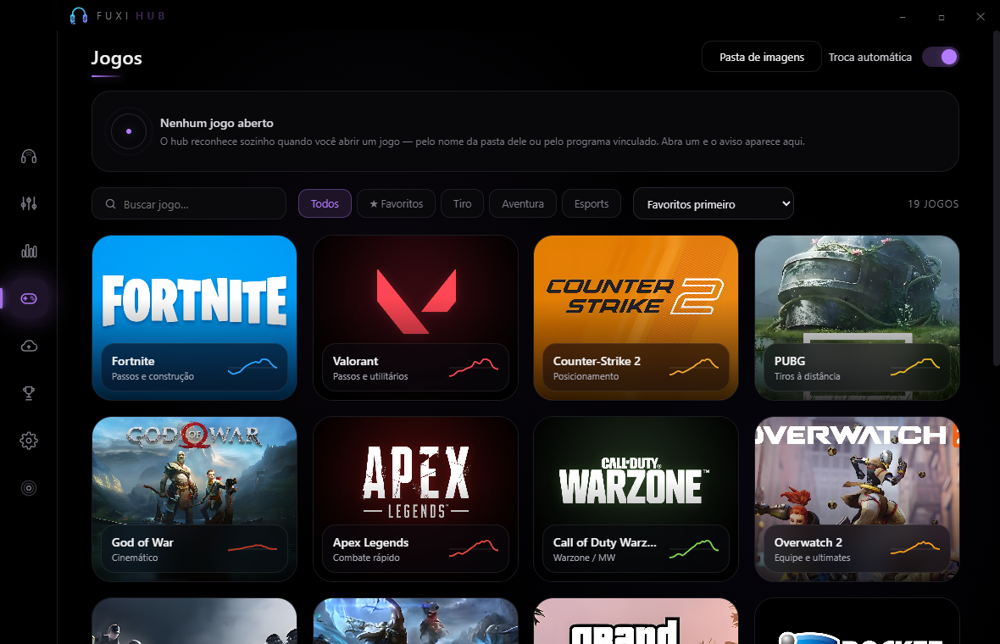
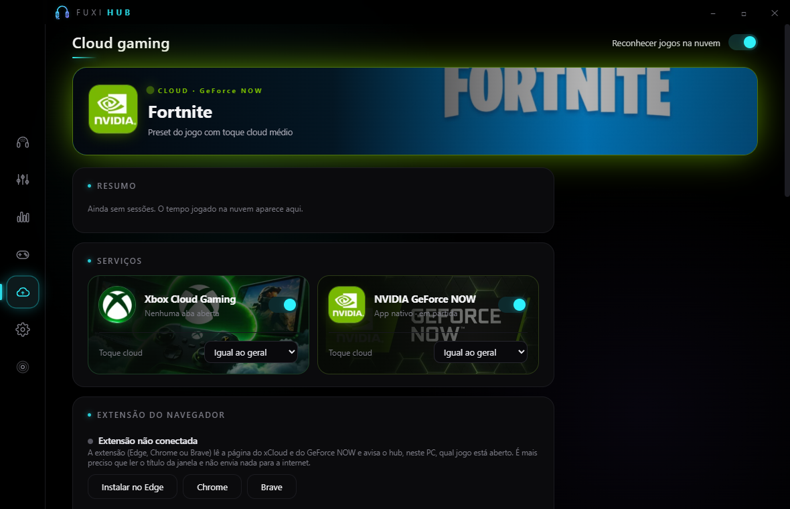
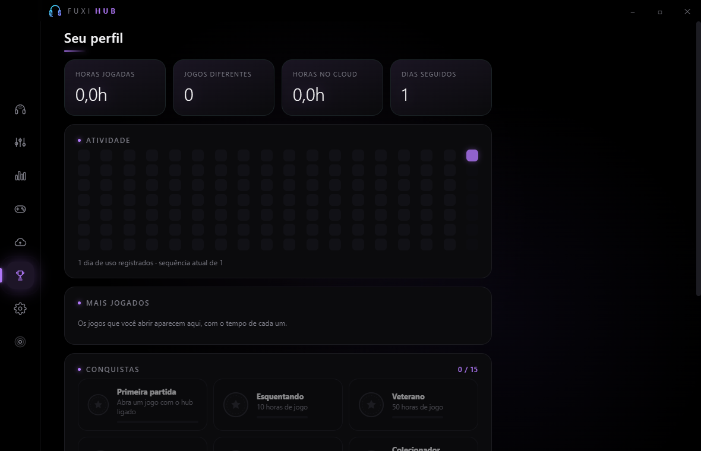
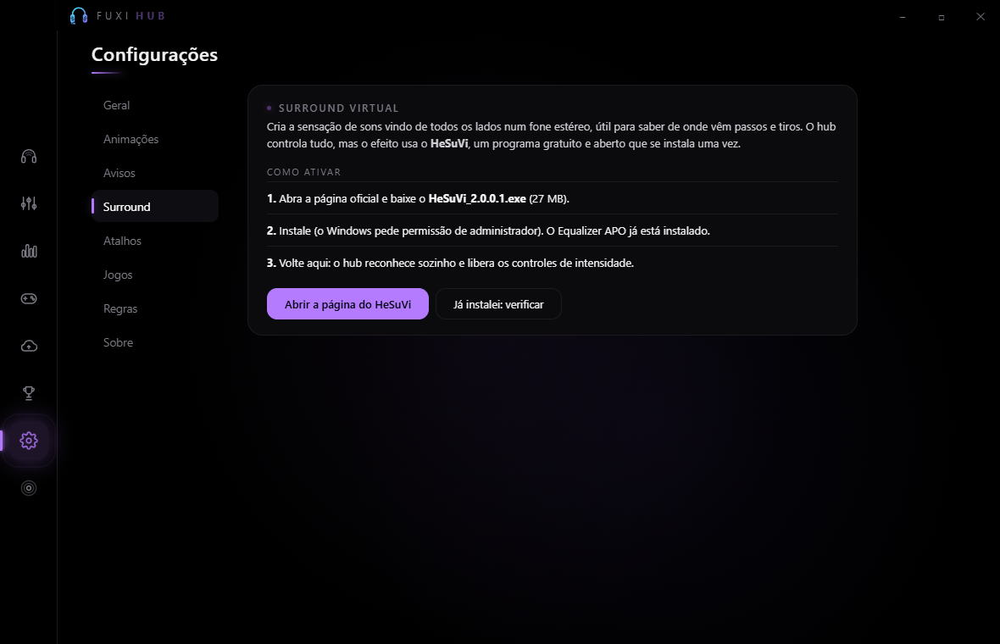
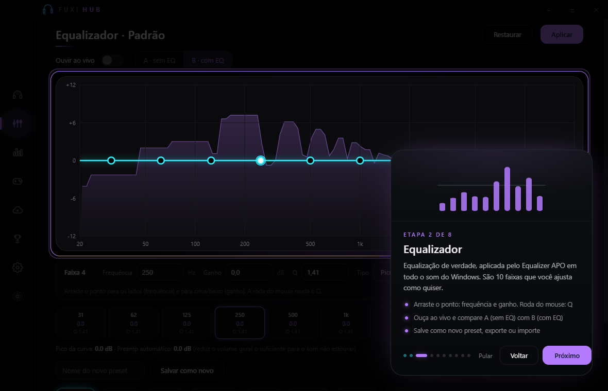
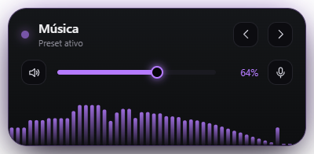

<div align="center">

# Fuxi Hub

**Central de controle para o headset Havit Fuxi H3 no Windows**
Equalizador real, presets automáticos por jogo, mixer por app, cloud gaming, surround virtual e muito mais, num app preto AMOLED e minimalista.

[](../../releases/latest)




</div>

> **English (short):** The app is available in Portuguese, English and Spanish (Settings → General → Language).
>
> **English (short):** Fuxi Hub is a Windows desktop app (Electron) for the Havit Fuxi H3 gaming headset. It drives a real 10-band parametric EQ through [Equalizer APO](https://sourceforge.net/projects/equalizerapo/), switches presets automatically per game, has a per-app mixer, cloud-gaming detection (xCloud / GeForce NOW), optional virtual surround via HeSuVi, a browser extension, a floating mini-window and a first-run tutorial. The interface is in Brazilian Portuguese. Download the installer from the [Releases](../../releases/latest) page.

---

## O que é

O **Fuxi Hub** é um aplicativo para Windows feito para o headset **Havit Fuxi H3** (USB `040B:0897`). Ele reconhece o fone, aplica uma equalização de verdade em todo o som do PC e troca sozinho o preset conforme o jogo que você abre. Também funciona, em modo compatível, com outros fones.

Tudo roda **localmente no seu PC**: não há conta, nuvem própria, telemetria nem anúncios.

## Funcionalidades

### Som
- **Equalizador de 10 faixas**, com frequência, ganho, Q e tipo (pico, shelf de graves e de agudos) por faixa. Aplicado pelo [Equalizer APO](https://sourceforge.net/projects/equalizerapo/) em todo o áudio do Windows.
- **Ouvir ao vivo** com comparação **A (sem EQ) × B (com EQ)** no mesmo volume e preamp automático para evitar estouro.
- **Presets prontos** (Padrão, Música, Filmes, Chamadas, Jogos) e seus próprios presets, com exportar e importar.
- **Surround virtual** em 3 níveis de intensidade (leve, médio, forte), usando o [HeSuVi](https://sourceforge.net/projects/hesuvi/) (gratuito, instalado à parte; o hub só o controla).
- **Mixer por app**, volume geral e microfone, com atalho para mutar.

### Jogos
- **20 jogos com preset próprio**, calibrados por jogo (passos, tiros, ambiente, cinemático…): Fortnite, Valorant, Counter-Strike 2, PUBG, God of War, Apex Legends, Call of Duty Warzone, Overwatch 2, Rainbow Six Siege, League of Legends, GTA V, Rocket League, Cyberpunk 2077, Elden Ring, Red Dead Redemption 2, Dota 2, Battlefield 2042, Escape from Tarkov, The Witcher 3 e THE FINALS.
- **Troca automática**: o hub percebe o jogo aberto, aplica o preset e volta ao anterior quando você fecha.
- **Reconhece qualquer jogo instalado** (Steam, Epic, Riot, Ubisoft, GOG, EA, Xbox, Rockstar) e aplica o preset "Jogos".
- **Regras por programa** (por exemplo, Discord → Chamadas).
- **Música e vídeo**: reconhece o **Spotify** (app e web) e o **YouTube** (web) e troca para o preset *Música* ou *Filmes* ao abrir ou ao tocar, voltando ao anterior quando param. Jogos e regras têm prioridade.
- Aviso animado no canto da tela ao entrar e sair do jogo, com som próprio. Modo **não incomodar jogando**.

### Cloud gaming
- Reconhece jogos do **Xbox Cloud Gaming** e do **NVIDIA GeForce NOW**, no navegador e nos apps do Windows.
- **Extensão para Edge, Chrome e Brave** que lê a página e avisa o hub por um servidor local (`127.0.0.1`, protegido por token).
- **Toque cloud**: compensa o som comprimido do streaming (níveis leve, médio, forte ou personalizado em 6 faixas), com nível por serviço e surround próprio.
- **Sessão manual** para quando um app não mostra o nome do jogo.

### Visual e extras
- Visualizador de **espectro de áudio** ao vivo, transição de cor ao trocar de preset, fone que reage ao jogo e ao microfone mutado.
- **Idiomas**: português, inglês e espanhol, com troca na hora.
- **Estilos do app**: AMOLED, Vidro, Neon e Papel (tema claro), com transição animada.
- **Cor do app**: automática (segue o preset) ou fixa. Três cores de fone: branco, preto e branco, e preto.
- **Seu perfil**: horas jogadas, sequência de dias, jogos mais jogados e 15 conquistas.
- **Tocando agora**: mini player do Spotify (lê a mídia do Windows, mesmo com o app na bandeja): disco girando num canto da tela, que dá uma voltinha com botões de anterior, pausar e próxima ao passar o mouse, e mostra o nome a cada música nova (na versão web, com a capa do álbum; o hub baixa a capa direto do site do Spotify).
- **Ajuste do microfone**: ganho, corte de graves e equalização da voz, aplicados pelo Equalizer APO sem mexer na saída de som.
- **Atualização automática**: o hub confere o GitHub, baixa a versão nova em segundo plano, confere o SHA-256 e instala quando você aceitar.
- **Controle pelo celular**: QR code para abrir uma página na sua rede Wi-Fi e trocar preset, volume e microfone sem sair do jogo (desligado por padrão, protegido por um código secreto).
- **Fone em 3D**: modelo 3D animado do Fuxi H3, montado em código com three.js, que reage ao áudio e ao microfone mutado (experimental, desligado por padrão; liga pelo botão "3D" no Início).
- **Mini-janela** flutuante (`Ctrl+Alt+V`) com preset, volume, microfone e espectro.
- **Tutorial animado** na primeira abertura, que começa quando o Fuxi H3 é reconhecido.
- Bandeja do sistema, **atalhos globais**, início com o Windows, backup automático e manual.

### Atalhos padrão

| Atalho | Ação |
|---|---|
| `Ctrl+Alt+M` | Mutar / ativar microfone |
| `Ctrl+Alt+→` / `Ctrl+Alt+←` | Próximo / anterior preset |
| `Ctrl+Alt+B` | Equalizador ligado / desligado |
| `Ctrl+Alt+F` | Abrir o Fuxi Hub |
| `Ctrl+Alt+V` | Mini-janela |

Todos podem ser alterados em Configurações → Atalhos.

## Capturas de tela

| Equalizador | Jogos |
|---|---|
|  |  |

| Cloud gaming | Seu perfil |
|---|---|
|  |  |

| Surround | Tutorial | Mini-janela |
|---|---|---|
|  |  |  |

## Instalação

**Requisitos:** Windows 10 ou 11 (64 bits) e o [Equalizer APO](https://sourceforge.net/projects/equalizerapo/) instalado (é ele que aplica a equalização).

1. Instale o **Equalizer APO** e, no *Configurator* dele, marque o dispositivo de saída do Fuxi H3 (o hub tem atalhos para isso na aba **Dispositivo**).
2. Baixe o **`Fuxi Hub Setup x.y.z.exe`** na página de [**Releases**](../../releases/latest) e execute.
3. Abra o Fuxi Hub, conecte o Fuxi H3 e siga o tutorial.

> **Aviso do Windows (SmartScreen):** o instalador **não é assinado digitalmente** (certificado de assinatura é pago), então o Windows pode mostrar "editor desconhecido". Clique em **Mais informações → Executar assim mesmo**. Se preferir, confira o SHA-256 listado na página da release ou compile você mesmo (abaixo).
>
> O app pede permissão de administrador porque o Equalizer APO grava seus arquivos de configuração numa pasta protegida.

### Extensão do navegador (cloud gaming)

1. Em Cloud gaming, clique em **Instalar no Edge** (ou Chrome / Brave). O hub abre a pasta da extensão e a página de extensões.
2. Ative o **Modo do desenvolvedor**, clique em **Carregar sem pacote** e escolha a pasta `extension` aberta pelo hub.
3. Abra um jogo no xCloud ou no GeForce NOW: o status passa a "Extensão conectada".

A extensão só conversa com o hub neste PC (`127.0.0.1`) e só roda em `xbox.com/play`, `geforcenow.com`, `open.spotify.com` e `youtube.com`.

## Desempenho

O Fuxi Hub foi feito para ficar na bandeja gastando pouco: ao fechar a janela (X), a interface é descartada e o app fica com **2 processos e cerca de 70 MB**, usando menos de 1% de CPU. Com a janela aberta ficam 3 processos e cerca de 200 MB.

- A **aceleração por GPU vem desligada** por padrão (economiza cerca de 500 MB). Quem preferir as animações mais fluidas e o 3D mais suave liga em Configurações → Geral → Desempenho (o app reinicia).
- Avisos, selo de jogo, disco do Spotify e mini-janela só existem enquanto aparecem.
- **Modo jogo:** com um aplicativo em tela cheia, o hub fica só com o essencial (preset, atalhos, avisos, microfone) e deixa a parte visual parada. Volta ao normal ao sair da tela cheia. Dá para desligar em Configurações → Geral → Desempenho, e há uma lista de exceções: vídeos e navegador em tela cheia não ligam o modo, e você pode escolher programas que sempre ligam.
- **Bateria do fone:** mostrada na tela inicial e no selo do jogo, com aviso aos 20% e 10% (quando o Windows informa o nível do fone Bluetooth).
- **Jogos instalados:** a aba Jogos procura jogos da Steam, Epic e Riot sem preset e deixa adicionar com um clique.

## Privacidade

- Nenhum dado seu sai do PC. O app não tem telemetria nem servidores próprios.
- As únicas conexões externas são: a consulta de versão nova à API pública do GitHub (só o download automático pode ser desligado, em Configurações → Sobre), a capa do álbum, baixada do site do Spotify quando você usa a extensão, e as páginas que você abre pelos botões (Equalizer APO e HeSuVi).
- O servidor local da extensão escuta só em `127.0.0.1`, exige um token gerado neste PC e recusa pedidos vindos de páginas da web.

## Compilar do código-fonte

Requisitos: [Node.js](https://nodejs.org/) 20+ e Windows.

```bash
git clone https://github.com/BIELZINinn/fuxi-hub.git
cd fuxi-hub
npm install
npm start          # roda em modo de desenvolvimento
npm run dist       # gera o instalador em dist/
```

Os utilitários nativos (`native/*.exe`: mixer/microfone, leitura de processos e HID) já vêm compilados. Para recompilar: `npm run native` (usa o compilador C# do próprio Windows, `csc.exe`).

### Estrutura

```
main.js, preload*.js   processo principal do Electron (EQ, detecção de jogos, tray, atalhos, servidor local)
src/                   interface (HTML/CSS/JS puro): abas, tutorial, perfil, mini-janela, espectro
data/games.json        presets dos 20 jogos
extension/             extensão MV3 do navegador (xCloud e GeForce NOW)
native/                utilitários em C# (áudio, processos, HID) e script de compilação
assets/                marca, fotos do fone, artes dos jogos e logos dos serviços
tools/                 scripts de desenvolvimento (capturas de tela, imagens, simulações)
```

## Limitações conhecidas

- A detecção do jogo no **GeForce NOW** e no **app do Xbox** depende do que cada app mostra no título da janela, e isso pode variar. Para esses casos existe a **sessão manual**.
- O som do **surround** e o reconhecimento em **cloud** dependem do HeSuVi e do navegador; nem tudo foi testado em todas as configurações.
- As traduções para **inglês e espanhol** foram escritas à mão e cobrem a interface e os avisos; alguns textos raros podem aparecer em português. Sugestões de correção são bem-vindas.
- As cores *preto* e *preto e branco* do fone na tela inicial são ilustrações do app, e o **modelo 3D** é uma interpretação estilizada do Fuxi H3, não uma cópia fiel.
- O **controle pelo celular** usa HTTP na rede local, sem criptografia: ligue só em redes em que você confia.

## Sons de entrada

O app traz sons de entrada para Fortnite, Valorant, CS2, PUBG, Apex Legends, Rocket League e THE FINALS, cortados de trechos de áudio ligados a esses jogos e músicas. Eles pertencem aos seus donos e estão aqui só para identificação e uso pessoal. Se você é dono de algum e quer a remoção, abra uma *issue*. Você pode trocar qualquer som colocando um arquivo com o id do jogo (por exemplo ortnite.mp3) na pasta de sons do app.

## Avisos legais

O Fuxi Hub é um projeto independente e **não é afiliado, apoiado ou endossado** pela Havit, Microsoft, Xbox, NVIDIA, Valve, Epic Games ou por qualquer empresa citada. Nomes, logos, artes de jogos e fotos de produto pertencem aos seus respectivos donos e são usados apenas para identificação. Se você é dono de algum material e quer que seja removido, abra uma *issue*.

Agradecimentos aos projetos [Equalizer APO](https://sourceforge.net/projects/equalizerapo/) e [HeSuVi](https://sourceforge.net/projects/hesuvi/), que fazem o trabalho pesado de áudio, e ao [Electron](https://www.electronjs.org/).

## Licença

O código do Fuxi Hub é distribuído sob a licença **MIT** (veja [LICENSE](LICENSE)). Imagens e marcas de terceiros não estão cobertas por essa licença.
